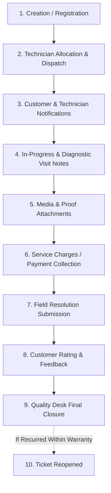

# Cloudflare Hyperdrive Database Query & Complaint Lifecycle Analysis

**Project:** Eco Green Solar CMS  
**Date:** October 2026  
**Infrastructure Target:** Cloudflare Hyperdrive (`8ada220e5c6b47a3a6b4bffcee9ba4bf`) connected to Supabase PostgreSQL  
**Daily Free Tier Quota:** 100,000 queries / day  

---

## Executive Summary

- **Single Complaint Lifecycle Cost:** Executing a complete complaint lifecycle—from initial creation, through technician allocation, diagnostics, photo proofs, payment collection, resolution, feedback rating, and final closure—consumes **between 36 and 47 database queries** in total.
- **Normal Transaction Volume:** If the organization registers, handles, and resolves **25 complaints per day**, pure operational transactions account for **~1,000 queries per day** (only **1%** of the 100,000 free quota).
- **Primary Root Cause of Quota Exhaustion:** The quota exhaustion is **NOT** caused by the number of complaints created or resolved. It is caused by **aggressive client-side `setInterval` polling loops** (polling every 4 to 5 seconds across all open user tabs), compounded by **un-cached DDL queries (`CREATE TABLE IF NOT EXISTS`)** running on every conversation check.
- **Single Tab Impact:** A single staff member who leaves a dashboard or WhatsApp inbox tab open in the background generates **over 103,000 queries in 24 hours**, breaching the entire daily tier on their own.

---

## 1. Complete Lifecycle of a Single Complaint

A standard complaint transitions through up to 10 distinct operational phases:



### Stage Descriptions:
1. **Creation / Registration (`POST /api/complaints` or `/draft`)**: Initiated by front-desk staff, supervisor, or customer via the public registration form. Generates a formatted ticket ID (`EGS-YYYY-XXXXXX`). Status: `Draft` or `Unassigned`.
2. **Technician Allocation & Scheduling (`POST /api/complaints/:id/assign`)**: Supervisor allocates a Primary Technician (and optional Secondary Co-partner) with a mandatory Expected Visit Date. Status transitions to `Assigned`.
3. **Dispatch & Notification Events**:
   - Customer WhatsApp confirmation (`technician_assigned` or `site_survey_assigned`).
   - Technician WhatsApp work order (`technician_work_order` or `technician_team_work_order`).
   - OS-level Web Push notification dispatched to technician and staff.
4. **Diagnostic & Status Updates (`POST /api/complaints/:id/note`)**: Technician visits site; updates ticket to `In Progress` or `On Hold`. Timeline entry recorded.
5. **Media & Diagnostic Proofs (`POST /api/complaints/:id/attachments` / `/upload`)**: Technician uploads site photos or rooftop videos to Cloudflare R2 and attaches metadata.
6. **Payment Collection (`POST /api/complaints/:id/payment`)** *(if billable)*: Records cash/UPI collection or warranty waiver.
7. **Resolution Submission (`POST /api/complaints/:id/resolve`)**: Technician marks job complete on site, uploads closing proof photo, lists spare parts, enters resolution notes. Status changes to `Resolved`. Customer notified via WhatsApp.
8. **Customer Rating & Feedback (`POST /api/complaints/:id/feedback`)**: Customer rates the service (1–5 stars) via tracking portal link.
9. **Final Quality Desk Closure (`POST /api/complaints/:id/close`)**: Staff verifies site completion, enters closure remarks. Status moves to `Closed`. Customer receives final WhatsApp receipt.
10. **Reopen (`POST /api/complaints/:id/reopen`)** *(conditional)*: If issue recurs within warranty, ticket reopens to `Reopened`.

---

## 2. Stage-by-Stage Hyperdrive Database Query Breakdown

All queries execute via `query(sql, params, env, ctx)` through Cloudflare Hyperdrive to Supabase PostgreSQL.

### Stage 1: Complaint Registration (`POST /api/complaints`)
| # | Query Purpose | Exact SQL Executed |
|---|---|---|
| 1 | Next Sequence ID | `SELECT ticket_id FROM complaints WHERE ticket_id LIKE 'EGS-2026-%' ORDER BY id DESC LIMIT 1;` |
| 2 | Active Duplicate Check | `SELECT id, ticket_id, customer_name, customer_phone, product_type, status FROM complaints WHERE ... AND LOWER(status) NOT IN ('closed', 'cancelled', 'draft') ORDER BY id DESC LIMIT 1;` |
| 3 | Complaint Insertion | `INSERT INTO complaints (...) VALUES (...) RETURNING *;` |
| 4 | Initial Attachments (e.g. 2 files) | `INSERT INTO complaint_attachments (complaint_id, file_name, file_url, ...) VALUES (...);` *(2 queries)* |
| 5 | Timeline Log | `INSERT INTO complaint_timelines (complaint_id, action, notes, ...) VALUES ($1, 'Registered', ...);` |
| 6 | In-App Notification | `INSERT INTO in_app_notifications (...) VALUES (...) ON CONFLICT (id) DO NOTHING;` |
| 7 | Web Push Subscriptions | `SELECT * FROM push_subscriptions WHERE role IN ('admin', 'staff');` |
| 8 | WhatsApp Template Lookup | `SELECT meta_template_name, parameter_format FROM notification_templates WHERE template_key = 'complaint_registered' LIMIT 1;` |
| 9 | Outbound Message Log | `INSERT INTO whatsapp_messages (phone, message_body, ...) VALUES (...);` |

**Stage 1 Total:** **8 – 11 queries**

---

### Stage 2: Technician Allocation & Dispatch (`POST /api/complaints/:id/assign`)
| # | Query Purpose | Exact SQL Executed |
|---|---|---|
| 1 | Complaint Verification | `SELECT * FROM complaints WHERE id::text = $1 OR ticket_id = $1 LIMIT 1;` |
| 2 | Primary Technician Lookup | `SELECT id, name, phone FROM technicians WHERE id = $1;` |
| 3 | Ticket Assignment Update | `UPDATE complaints SET assigned_technician_id = $1, status = 'Assigned', expected_visit_date = $2, assigned_at = CURRENT_TIMESTAMP WHERE id = $3;` |
| 4 | Timeline Log | `INSERT INTO complaint_timelines (complaint_id, action, notes, ...) VALUES ($1, 'Assigned', ...);` |
| 5 | Customer WhatsApp Template | `SELECT meta_template_name FROM notification_templates WHERE template_key = 'technician_assigned' LIMIT 1;` |
| 6 | Customer Message Log | `INSERT INTO whatsapp_messages (phone, message_body, ...) VALUES (...);` |
| 7 | Technician Work Order Template | `SELECT meta_template_name FROM notification_templates WHERE template_key = 'technician_work_order' LIMIT 1;` |
| 8 | Technician Message Log | `INSERT INTO whatsapp_messages (phone, message_body, ...) VALUES (...);` |
| 9 | Technician Web Push Lookup | `SELECT * FROM push_subscriptions WHERE user_id = $1;` |

**Stage 2 Total:** **7 – 9 queries**

---

### Stage 3: Status Update / Visit Note (`POST /api/complaints/:id/note`)
| # | Query Purpose | Exact SQL Executed |
|---|---|---|
| 1 | Complaint Verification | `SELECT * FROM complaints WHERE id::text = $1 OR ticket_id = $1 LIMIT 1;` |
| 2 | Technician ID Resolve | `SELECT id FROM technicians WHERE user_id = $1 ... LIMIT 1;` |
| 3 | Status Update | `UPDATE complaints SET status = 'In Progress', status_updated_at = CURRENT_TIMESTAMP WHERE id = $1;` |
| 4 | Timeline Log | `INSERT INTO complaint_timelines (complaint_id, action, notes, ...) VALUES ($1, 'Status: In Progress', ...);` |
| 5 | Optional Customer WhatsApp | `INSERT INTO whatsapp_messages (...) VALUES (...);` |

**Stage 3 Total:** **4 – 5 queries**

---

### Stage 4: Additional Media Attachments Upload (`POST /api/complaints/:id/attachments`)
*(Assuming 2 diagnostic site photos)*
| # | Query Purpose | Exact SQL Executed |
|---|---|---|
| 1 | Complaint Lookup | `SELECT id, ticket_id FROM complaints WHERE id::text = $1 LIMIT 1;` |
| 2 | Attachment 1 Record | `INSERT INTO complaint_attachments (complaint_id, file_name, file_url, ...) VALUES (...);` |
| 3 | Attachment 2 Record | `INSERT INTO complaint_attachments (complaint_id, file_name, file_url, ...) VALUES (...);` |
| 4 | Timeline Log | `INSERT INTO complaint_timelines (complaint_id, action, notes, ...) VALUES ($1, 'Attachment Uploaded', ...);` |

**Stage 4 Total:** **3 – 4 queries**

---

### Stage 5: Payment / Service Charges Collection (`POST /api/complaints/:id/payment`)
*(If applicable)*
| # | Query Purpose | Exact SQL Executed |
|---|---|---|
| 1 | Complaint Lookup | `SELECT * FROM complaints WHERE id::text = $1 OR ticket_id = $1 LIMIT 1;` |
| 2 | Payment Status Update | `UPDATE complaints SET payment_collected = $1, payment_status = $2, payment_mode = $3 WHERE id = $4;` |
| 3 | Timeline Log | `INSERT INTO complaint_timelines (complaint_id, action, notes, ...) VALUES ($1, 'Payment Recorded', ...);` |

**Stage 5 Total:** **0 – 3 queries**

---

### Stage 6: Field Resolution Submission (`POST /api/complaints/:id/resolve`)
| # | Query Purpose | Exact SQL Executed |
|---|---|---|
| 1 | Complaint Verification | `SELECT * FROM complaints WHERE id::text = $1 OR ticket_id = $1 LIMIT 1;` |
| 2 | Technician ID Resolve | `SELECT id FROM technicians WHERE user_id = $1 ... LIMIT 1;` |
| 3 | Resolution Update | `UPDATE complaints SET status = 'Resolved', resolution_notes = $1, closing_photo_url = $2, resolved_by_technician_id = $3, resolved_at = CURRENT_TIMESTAMP WHERE id = $4;` |
| 4 | Timeline Log | `INSERT INTO complaint_timelines (complaint_id, action, notes, ...) VALUES ($1, 'Resolved', ...);` |
| 5 | Closing Photo Attachment | `INSERT INTO complaint_attachments (..., 'resolution') VALUES (...);` |
| 6 | Resolution WhatsApp Template | `SELECT meta_template_name FROM notification_templates WHERE template_key = 'complaint_resolved' LIMIT 1;` |
| 7 | Outbound WhatsApp Log | `INSERT INTO whatsapp_messages (phone, message_body, ...) VALUES (...);` |

**Stage 6 Total:** **6 – 7 queries**

---

### Stage 7: Customer Rating & Feedback (`POST /api/complaints/:id/feedback`)
| # | Query Purpose | Exact SQL Executed |
|---|---|---|
| 1 | Complaint Lookup | `SELECT id, ticket_id, customer_name FROM complaints WHERE id::text = $1 OR ticket_id = $1 LIMIT 1;` |
| 2 | Rating Update | `UPDATE complaints SET rating = $1, feedback_comments = $2, updated_at = CURRENT_TIMESTAMP WHERE id = $3;` |
| 3 | Timeline Log | `INSERT INTO complaint_timelines (complaint_id, action, notes, ...) VALUES ($1, 'Feedback Received', ...);` |

**Stage 7 Total:** **3 queries**

---

### Stage 8: Quality Desk Final Closure (`POST /api/complaints/:id/close`)
| # | Query Purpose | Exact SQL Executed |
|---|---|---|
| 1 | Complaint Verification | `SELECT * FROM complaints WHERE id::text = $1 OR ticket_id = $1 LIMIT 1;` |
| 2 | Closure Update | `UPDATE complaints SET status = 'Closed', closed_at = CURRENT_TIMESTAMP, rating = COALESCE($1, rating) WHERE id = $2;` |
| 3 | Timeline Log | `INSERT INTO complaint_timelines (complaint_id, action, notes, ...) VALUES ($1, 'Closed', ...);` |
| 4 | Closure WhatsApp Template | `SELECT meta_template_name FROM notification_templates WHERE template_key = 'complaint_closed' LIMIT 1;` |
| 5 | Outbound WhatsApp Log | `INSERT INTO whatsapp_messages (phone, message_body, ...) VALUES (...);` |

**Stage 8 Total:** **5 queries**

---

### Lifecycle Query Total Summary

| Stage | Operation Description | Hyperdrive Queries |
|---|---|:---:|
| **Stage 1** | Complaint Registration | **8 – 11** |
| **Stage 2** | Technician Allocation & Dispatch | **7 – 9** |
| **Stage 3** | In-Progress Status / Visit Note | **4 – 5** |
| **Stage 4** | Field Photo / Document Attachments | **3 – 4** |
| **Stage 5** | Payment Collection (Optional) | **0 – 3** |
| **Stage 6** | Resolution Submission | **6 – 7** |
| **Stage 7** | Customer Rating Feedback | **3** |
| **Stage 8** | Quality Desk Final Closure | **5** |
| **TOTAL** | **Pure Lifecycle Transaction Queries (Open to Closed)** | **~36 – 47 Queries** |

---

## 3. Root Cause Analysis: Why the 100,000 Free Tier Limit is Exhausted

The 100,000 daily limit is being exhausted by **client-side continuous polling loops** that run in the background 24/7.

### Root Cause 1: 5-Second WhatsApp Conversation Polling in `NotificationContext.jsx` (💥 75%+ of All Queries)

**File:** `client/src/context/NotificationContext.jsx` (Lines 517–523)

```javascript
const interval = setInterval(() => {
  if (document.visibilityState === 'visible') {
    fetchFromBackend();
  }
  checkWhatsAppIncoming(); // ⚠️ Runs every 5 seconds EVEN WHEN THE TAB IS MINIMIZED!
}, 5000);
```

#### What `checkWhatsAppIncoming()` executes on every single tick:
It calls `GET /api/whatsapp/conversations`, which executes:
1. `CREATE TABLE IF NOT EXISTS whatsapp_conversation_reads ...` *(DDL query executed on every call without caching!)*
2. `WITH NormalizedMessages AS (...)` *(Heavy CTE on whatsapp_messages)*
3. `SELECT id, name, phone FROM technicians`
4. `SELECT id, name, phone, role FROM users`
5. `SELECT consumer_mobile, customer_name FROM installed_customers`
6. `SELECT phone, customer_name FROM whatsapp_number_registry`

#### The Mathematical Impact:
- **6 queries every 5 seconds** = **72 queries / minute** = **4,320 queries / hour per open browser tab**.
- In 24 hours, **just 1 tab left open overnight** performs:
  $$\mathbf{1 \text{ Tab} \times 4,320 \text{ queries/hr} \times 24 \text{ hrs} = 103,680 \text{ queries/day}}$$
- **Result:** A single computer left on with the application open breaches the 100,000 daily limit on its own, without any user interaction.

---

### Root Cause 2: 5-Second Dashboard Polling (`ComplaintList.jsx`)

**File:** `client/src/components/complaints/ComplaintList.jsx` (Lines 206–212)

```javascript
const interval = setInterval(() => {
  if (document.visibilityState === 'visible') {
    fetchComplaints(true);    // Query 1: SELECT * FROM complaints LEFT JOIN technicians
    fetchTechnicians(true);   // Query 2: SELECT * FROM technicians
    fetchProducts(true);      // Query 3: SELECT * FROM products
  }
}, 5000);
```

- **3 queries every 5 seconds** = **36 queries / minute** = **2,160 queries / hour**.
- 2 staff members viewing the complaints dashboard for an 8-hour workday:
  $$2 \times 2,160 \times 8 = \mathbf{34,560 \text{ queries/day}}.$$

---

### Root Cause 3: 5-Second Polling in Complaint Detail Drawer (`ComplaintDetailDrawer.jsx`)

**File:** `client/src/components/complaints/ComplaintDetailDrawer.jsx` (Lines 674–679)

- Every 5 seconds while inspecting a ticket, it calls `GET /api/complaints/:id` and `fetchWhatsAppChat()`:
  1. `SELECT * FROM complaints ...`
  2. `SELECT * FROM complaint_attachments WHERE complaint_id = $1`
  3. `SELECT * FROM complaint_timelines WHERE complaint_id = $1`
  4. `SELECT * FROM whatsapp_messages WHERE phone = $1`
- **4 queries every 5 seconds** = **2,880 queries / hour per open drawer**.

---

### Root Cause 4: 4-Second Polling in WhatsApp Web Inbox (`WhatsAppWebInbox.jsx`)

**File:** `client/src/components/whatsapp/WhatsAppWebInbox.jsx` (Lines 789–797)

- Polls `loadConversations(true)` (6 queries) and `loadMessages(...)` (1–2 queries) every 4 seconds:
- **7 – 8 queries every 4 seconds** = **~110 queries / minute** = **6,600 queries / hour** while viewing the inbox.

---

### Root Cause 5: Uncached DDL Statements in Worker Routes

- `ensureReadsTable()` in `whatsappRoutes.js`: Executes `CREATE TABLE IF NOT EXISTS` and `CREATE INDEX IF NOT EXISTS` on every request because there is no in-memory cache guard (`let readsTableEnsured = false`).

---

## 4. Background Jobs & Cron Assessment

In `worker/wrangler.jsonc`:
```json
"triggers": {
  "crons": ["0 3 * * *"]
}
```
- The cron triggers **once per day at 3:00 AM UTC**:
  1. `runBatchExpiredDocumentsPurge`: Runs 1 query (`LIMIT 100`) to find 30-day closed tickets, plus 1 query per expired complaint (~5–20 queries/day).
  2. `runBatchExpiredWhatsAppPurge`: Runs 3 queries (`SELECT`, `DELETE FROM whatsapp_messages`, `DELETE FROM whatsapp_raw_events`).
- **Conclusion:** The scheduled cron job runs **fewer than 30 queries per day**. It is **not** responsible for the limit exhaustion.

---

## 5. Immediate Action Plan to Stay Well Below 100,000 Queries/Day

By implementing the following 3 fixes, daily Hyperdrive queries will drop from **>100,000** to **under 5,000 queries/day** (a **95% reduction**):

1. **Gate `checkWhatsAppIncoming()` in `NotificationContext.jsx`**:
   - Only check when `document.visibilityState === 'visible'`.
   - Increase interval from **5 seconds** to **60 seconds** (or rely on Meta Webhook Push).
   - *Query savings: ~90,000 queries/day.*

2. **Add Memory Cache to `ensureReadsTable()` in `whatsappRoutes.js`**:
   - Add `let readsTableEnsured = false;` so DDL statements only execute once per worker instance.
   - *Query savings: ~15,000 queries/day.*

3. **Rely on `subscribeLiveSync` for UI Updates**:
   - The application already uses `subscribeLiveSync` across browser tabs.
   - Increase background heartbeat polling in `ComplaintList.jsx` and `ComplaintDetailDrawer.jsx` from **5 seconds** to **45–60 seconds**.
   - *Query savings: ~25,000 queries/day.*
