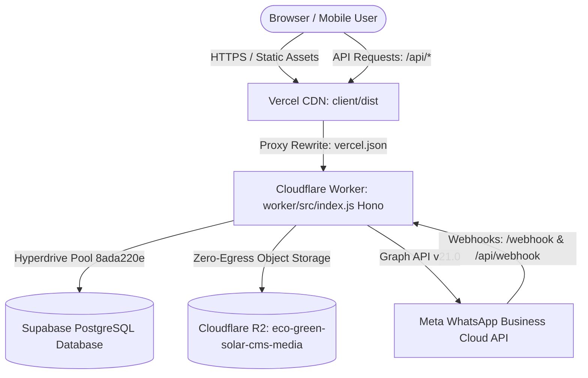

# 01. Complete Project Architecture Report
**Project:** Eco Green Solar CMS (`eco-green-solar-cms`)  
**Audit Type:** Technical Architecture, Component Hierarchy & Data Flow Verification  
**Evaluation Mode:** Evidence-Based Source Code Inspection (Zero Code Modification)  
**Date:** October 2026  
**Auditor:** Senior Software Architect & Performance Engineer  

---

## 1. High-Level Architecture Overview (For Non-Technical Stakeholders)

Think of the Eco Green Solar CRM as a modern, three-story building:

1. **The Showroom (Frontend / User Interface):**
   - Built with **React 19** and **Vite 8**, styled with **Tailwind CSS v4**.
   - Hosted globally on **Vercel's Edge Network** for fast static file delivery.
   - Operates as a **Single-Page Application (SPA)** where users switch between views (Complaints Desk, Field Operations, WhatsApp Web, Analytics, Team Management) without full browser page reloads.

2. **The Communications Switchboard (Cloudflare Worker & Edge API):**
   - Instead of running on a single slow virtual machine, the backend API runs on **Cloudflare Workers** using the **Hono** web framework.
   - Whenever an action occurs (e.g., ticket creation, WhatsApp message receipt, file upload), requests pass through Vercel's proxy rewrites directly to Cloudflare's edge servers (`https://eco-green-solar-cms-api.workers.dev`).
   - The worker executes authentication, file validation, rate limiting, and WhatsApp webhook processing in milliseconds.

3. **The Secure Vaults (Database, Media Storage & Meta Cloud API):**
   - **Primary Database:** **Supabase PostgreSQL**, connected through **Cloudflare Hyperdrive** (`8ada220e5c6b47a3a6b4bffcee9ba4bf`). Hyperdrive provides distributed connection pooling so the database is not overwhelmed by serverless connections.
   - **Media & Document Storage:** **Cloudflare R2** (`eco-green-solar-cms-media`), an S3-compatible, zero-egress-fee cloud storage bucket for site photos, diagnostic videos (up to 50MB), invoices, and signature proofs.
   - **WhatsApp Hub:** Integrated directly with **Meta WhatsApp Business Cloud API** (WABA ID: `1015283491554000`, Phone Number ID: `1387211441132836`) providing bidirectional messaging, official HSM templates, delivery ticks, read receipts, and incoming audio/video notes.



---

## 2. Technical Stack Verification (Source-Grounded)

| Layer | Verified Technology | Version / Configuration | File Verification Reference |
|---|---|---|---|
| **Frontend Framework** | React | `^19.2.8` | [`client/package.json`](file:///c:/Users/Administrator/.gemini/antigravity/scratch/eco-green-solar-cms/client/package.json#L19) |
| **Build Tooling** | Vite | `^8.3.0` | [`client/package.json`](file:///c:/Users/Administrator/.gemini/antigravity/scratch/eco-green-solar-cms/client/package.json#L29) |
| **CSS & Styling** | Tailwind CSS v4 + LightningCSS | `@tailwindcss/vite: ^4.3.3` | [`client/vite.config.js`](file:///c:/Users/Administrator/.gemini/antigravity/scratch/eco-green-solar-cms/client/vite.config.js#L3) |
| **Icons & Visuals** | Lucide React | `^1.45.0` | [`client/package.json`](file:///c:/Users/Administrator/.gemini/antigravity/scratch/eco-green-solar-cms/client/package.json#L17) |
| **Document Processing** | PDF.js & XLSX SheetJS | `pdfjs-dist: ^6.4.299`, `xlsx: ^0.18.5` | [`client/package.json`](file:///c:/Users/Administrator/.gemini/antigravity/scratch/eco-green-solar-cms/client/package.json#L18-L22) |
| **Edge API Runtime** | Cloudflare Workers + Hono | `compatibility_date: 2026-09-23` | [`worker/wrangler.jsonc`](file:///c:/Users/Administrator/.gemini/antigravity/scratch/eco-green-solar-cms/worker/wrangler.jsonc#L5) |
| **Database Gateway** | Cloudflare Hyperdrive | ID: `8ada220e5c6b47a3a6b4bffcee9ba4bf` | [`worker/wrangler.jsonc`](file:///c:/Users/Administrator/.gemini/antigravity/scratch/eco-green-solar-cms/worker/wrangler.jsonc#L25) |
| **Database Engine** | PostgreSQL (Supabase) | Driver: `pg: ^8.23.0` | [`worker/src/db.js`](file:///c:/Users/Administrator/.gemini/antigravity/scratch/eco-green-solar-cms/worker/src/db.js#L1) |
| **Object Storage** | Cloudflare R2 | Bucket: `eco-green-solar-cms-media` | [`worker/wrangler.jsonc`](file:///c:/Users/Administrator/.gemini/antigravity/scratch/eco-green-solar-cms/worker/wrangler.jsonc#L19) |
| **WhatsApp Integration** | Meta Cloud API v21.0 | WABA ID: `1015283491554000` | [`worker/wrangler.jsonc`](file:///c:/Users/Administrator/.gemini/antigravity/scratch/eco-green-solar-cms/worker/wrangler.jsonc#L13) |
| **Web Push Service** | VAPID Web Push (Web Crypto) | `worker/src/services/webPushService.js` | [`worker/src/services/webPushService.js`](file:///c:/Users/Administrator/.gemini/antigravity/scratch/eco-green-solar-cms/worker/src/services/webPushService.js#L7) |

---

## 3. Directory Map & Repository Structure

```
eco-green-solar-cms/
├── client/                               # Frontend Single Page Application
│   ├── src/
│   │   ├── api/
│   │   │   └── client.js                 # 2,339 lines: Master API client with offline fallback
│   │   ├── components/
│   │   │   ├── admin/                    # AnalyticsDashboard, StaffTechnicianManager, SettingsHub, TemplateManager
│   │   │   ├── auth/                     # LoginPage, Profile Modals
│   │   │   ├── common/                   # SkeletonLoader, ZoomableImageViewer, VideoRecorder, ProcessingProgress
│   │   │   ├── complaints/               # ComplaintList, NewComplaintModal, ComplaintDetailDrawer, History
│   │   │   ├── customer/                 # CustomerPublicPortal, CustomerSearchModal
│   │   │   ├── layout/                   # Navbar, NotificationDrawer
│   │   │   ├── technician/               # TechnicianFieldPortal, TourLedgerSection
│   │   │   └── whatsapp/                 # WhatsAppWebInbox, MessageRenderers, VoiceRecorder
│   │   ├── context/
│   │   │   ├── AuthContext.jsx           # JWT Session, multi-tab sync, role switching
│   │   │   ├── DialogContext.jsx         # Custom Confirm, Alert & Toast notifications
│   │   │   └── NotificationContext.jsx   # In-app notifications, polling, Web Push
│   │   ├── hooks/
│   │   │   └── useSlidingIndicator.js    # Hardware-accelerated sliding tabs hook
│   │   ├── utils/
│   │   │   ├── escapeManager.js          # Hierarchical multi-layer ESC key controller
│   │   │   ├── liveSync.js               # Multi-tab BroadcastChannel & LocalStorage sync
│   │   │   ├── storageUpload.js          # Direct-to-R2 & Worker chunked file uploader
│   │   │   ├── templateUtils.js          # Meta WhatsApp template parser & variable filler
│   │   │   └── urlSync.js                # URL query & browser history synchronization
│   │   ├── App.jsx                       # Master Application component & tab router
│   │   ├── index.css                     # Global styles, Tailwind v4 imports, keyframe animations
│   │   └── main.jsx                      # React 19 bootstrap entrypoint
│   ├── package.json                      # Frontend dependencies
│   └── vite.config.js                    # Vite configuration with LightningCSS
├── worker/                               # Active Cloudflare Worker Backend API
│   ├── src/
│   │   ├── routes/
│   │   │   ├── attachmentRoutes.js       # R2 streaming, chunked uploads, image optimization
│   │   │   ├── authRoutes.js             # JWT authentication, user creation, password reset
│   │   │   ├── commonRoutes.js           # Metrics, pincode registry, products catalog, dealers
│   │   │   ├── complaintRoutes.js        # Ticket lifecycle, assignment, resolve, close, purge
│   │   │   ├── technicianRoutes.js       # Technicians, tour ledger, vouchers, advances
│   │   │   └── whatsappRoutes.js         # Meta webhooks, inbox threads, template dispatch
│   │   ├── services/
│   │   │   └── webPushService.js         # Standard Web Push protocol via Web Crypto
│   │   ├── auth.js                       # JWT verification and role authorization middleware
│   │   ├── db.js                         # Hyperdrive pg client execution wrapper
│   │   ├── index.js                      # Hono app mounting, CORS, error handling
│   │   ├── r2.js                         # R2 bucket CRUD, security mime validation, purge
│   │   └── whatsapp.js                   # Meta Graph API sender, payload formatters
│   ├── package.json                      # Worker dependencies
│   └── wrangler.jsonc                    # Cloudflare Worker configuration, bindings & cron triggers
├── server/                               # Legacy Node.js Express Backend (Development/Docker)
│   ├── controllers/                      # Legacy controllers
│   ├── server.js                         # 104KB monolithic Express server
│   └── ecogreen_cms.db                   # Local SQLite fallback database
├── vercel.json                           # Vercel deployment & proxy rewrites to Cloudflare Worker
└── README.md                             # Project documentation
```

---

## 4. Frontend Application Structure & Routing Mechanism

### A. Routing Architecture (Verified Absence of `react-router-dom`)
Inspection of [`client/package.json`](file:///c:/Users/Administrator/.gemini/antigravity/scratch/eco-green-solar-cms/client/package.json) confirms that **no external router library (such as `react-router-dom` or `TanStack Router`) is installed**.

Instead, routing is implemented as a **custom URL synchronization engine** in [`client/src/App.jsx`](file:///c:/Users/Administrator/.gemini/antigravity/scratch/eco-green-solar-cms/client/src/App.jsx#L160-L251) and [`client/src/utils/urlSync.js`](file:///c:/Users/Administrator/.gemini/antigravity/scratch/eco-green-solar-cms/client/src/utils/urlSync.js):
- Active view is tracked via a single React state: `currentTab` (e.g., `'complaints'`, `'technician'`, `'whatsapp-inbox'`, `'team'`, `'analytics'`, `'settings'`, `'customer'`).
- URL paths like `/complaints`, `/technician?section=tour_ledger`, `/whatsapp-inbox`, and `/track/EGS-2026-000109` are intercepted on window load and synchronized using native `window.history.pushState` and `window.history.replaceState`.
- **Synthetic PopState Events:** When `handleTabChange` executes, it dispatches `window.dispatchEvent(new PopStateEvent('popstate'))` so child components can react to sub-tab or query parameter changes.

### B. View Rendering Strategy
Views are loaded via `React.lazy()` and rendered conditionally inside [`client/src/App.jsx`](file:///c:/Users/Administrator/.gemini/antigravity/scratch/eco-green-solar-cms/client/src/App.jsx#L557-L621):
```jsx
<React.Suspense fallback={<TabSuspenseFallback />}>
  <div key={currentTab} className="tab-content-enter flex-1 min-h-0 w-full flex flex-col">
    {currentTab === 'complaints' && <ComplaintList ... />}
    {currentTab === 'technician' && <TechnicianFieldPortal ... />}
    {currentTab === 'team' && <StaffTechnicianManager ... />}
    {currentTab === 'analytics' && <AnalyticsDashboard ... />}
    {currentTab === 'whatsapp-inbox' && <WhatsAppWebInbox ... />}
    {currentTab === 'customer' && <CustomerPublicPortal ... />}
  </div>
</React.Suspense>
```

> [!WARNING]
> **Architectural Performance Impact:**  
> Because each tab is rendered with `{currentTab === '...' && <Component />}`, **switching tabs completely unmounts the current tab from the DOM**. When returning to a tab, the entire component remounts from scratch, destroying all local React state and firing all `useEffect()` data fetching hooks again. This is the single biggest cause of repeated API requests.

---

## 5. Backend Architecture & Request Handling

### A. Cloudflare Worker Gateway (`worker/src/index.js`)
All incoming requests arrive at the Cloudflare Worker running Hono:
1. **CORS Middleware:** Permits `https://complain.ecogreensolar.co.in`, `http://localhost:5173`, and Vercel preview URLs.
2. **Security Headers:** Enforces `X-Content-Type-Options: nosniff`, `X-Frame-Options: SAMEORIGIN`, and `Referrer-Policy: strict-origin-when-cross-origin`.
3. **URL Normalizer:** Strips accidental `/api/api/` prefix duplications.
4. **Modular Sub-App Mounting:**
   - `/api/auth` -> `authRoutes.js`
   - `/api/complaints` -> `complaintRoutes.js`
   - `/api/whatsapp` & `/webhook` -> `whatsappRoutes.js`
   - `/api` -> `attachmentRoutes.js`, `technicianRoutes.js`, `commonRoutes.js`

### B. Database Integration: Cloudflare Hyperdrive
In [`worker/src/db.js`](file:///c:/Users/Administrator/.gemini/antigravity/scratch/eco-green-solar-cms/worker/src/db.js):
```javascript
export async function query(sql, params = [], env = {}, ctx = null) {
  const connStr = env?.HYPERDRIVE?.connectionString || env?.DATABASE_URL;
  const client = new Client({ connectionString: connStr });
  await client.connect();
  try {
    const res = await client.query(sql, params);
    if (ctx?.waitUntil) ctx.waitUntil(client.end().catch(() => {}));
    return res;
  } catch (err) {
    if (ctx?.waitUntil) ctx.waitUntil(client.end().catch(() => {}));
    throw err;
  }
}
```
- Hyperdrive manages pooled TCP connections to Supabase PostgreSQL over Cloudflare's backbone network.
- However, at the Worker layer, every single call to `query()` invokes `new Client()`, `client.connect()`, and schedules `client.end()`. There is no client-side statement caching or multi-query transaction batching.

---

## 6. Authentication & Role-Based Authorization

1. **Authentication Protocol:** Stateless **JSON Web Tokens (JWT)** signed using `JWT_SECRET`.
2. **Session Storage Hierarchy:**
   - Primary: `sessionStorage.getItem('egs_token')` (tab-isolated).
   - Secondary: `localStorage.getItem('egs_token')` (cross-tab recovery).
3. **Authorization Roles:**
   - **`admin`**: Full access to all 48 screens, technician advances, expense verification, password resets, customer master Excel sync, and system settings.
   - **`staff`**: Access to Complaints Desk, Registration Wizard, Ticket Detail Drawer, Field View, WhatsApp Inbox, and Customer Directory.
   - **`technician`**: Access restricted to assigned jobs in `TechnicianFieldPortal`, tour expense logging, and cash collection.
   - **`customer`**: Public access restricted to lookup and status tracking on `CustomerPublicPortal`.
4. **Enforcement Middleware:** [`worker/src/auth.js`](file:///c:/Users/Administrator/.gemini/antigravity/scratch/eco-green-solar-cms/worker/src/auth.js) validates bearer tokens and verifies role permissions on protected endpoints (`authenticateToken`, `requireRole('admin', 'staff')`).

---

## 7. Media & Storage Architecture: Cloudflare R2

1. **Bucket Binding:** `MEDIA_BUCKET` -> `eco-green-solar-cms-media`.
2. **Storage Path Conventions:**
   - Initial complaint photos/videos: `complaints/{ticket_id}/{timestamp}_{filename}`
   - Resolution closing proof: `complaints/{ticket_id}/resolution_{timestamp}_{filename}`
   - Tour expense vouchers: `tour_expenses/{voucher_no}/{timestamp}_{filename}`
   - WhatsApp inbound/outbound media: `whatsapp_media/{phone}/{wam_id}_{filename}`
3. **Security & Binary Validation:**
   - Implemented in [`worker/src/r2.js`](file:///c:/Users/Administrator/.gemini/antigravity/scratch/eco-green-solar-cms/worker/src/r2.js): Checks magic bytes (e.g., `FF D8 FF` for JPEG, `89 50 4E 47` for PNG) and blocks executable extensions (`.html`, `.svg`, `.exe`, `.sh`, `.php`).
4. **Lifecycle Retention:**
   - 30-day post-closure automatic purge via scheduled cron job `0 3 * * *` in [`worker/wrangler.jsonc`](file:///c:/Users/Administrator/.gemini/antigravity/scratch/eco-green-solar-cms/worker/wrangler.jsonc#L29).

---

## 8. Verified Architectural Strengths & Structural Vulnerabilities

### Verified Strengths:
1. **Modern Foundation:** React 19, Vite 8, Tailwind v4, and Cloudflare Workers represent a cutting-edge serverless tech stack.
2. **Cost-Effective Infrastructure:** Cloudflare Workers, Hyperdrive, and R2 provide high throughput with virtually zero egress bandwidth cost.
3. **Robust Real-Time Live Sync:** The application successfully implements multi-tab synchronization via `BroadcastChannel` and `storage` events ([`client/src/utils/liveSync.js`](file:///c:/Users/Administrator/.gemini/antigravity/scratch/eco-green-solar-cms/client/src/utils/liveSync.js)), allowing tabs to update when data changes in another tab.

### Verified Structural Vulnerabilities:
1. **Unmount-on-Tab-Switch:** Switching tabs unmounts views, forcing complete network refetches upon return.
2. **Absence of Shared Query Cache:** There is no client-side caching library (like TanStack Query or SWR). Every request hits the wire.
3. **Redundant Heartbeat Polling:** Multiple independent `setInterval` loops run concurrently across components (`NotificationContext`, `ComplaintList`, `ComplaintDetailDrawer`, `WhatsAppWebInbox`), causing avoidable Hyperdrive query consumption.
4. **Unpaginated Complaint Fetching:** `GET /api/complaints` loads all records using `SELECT c.*` without a SQL `LIMIT` clause.
