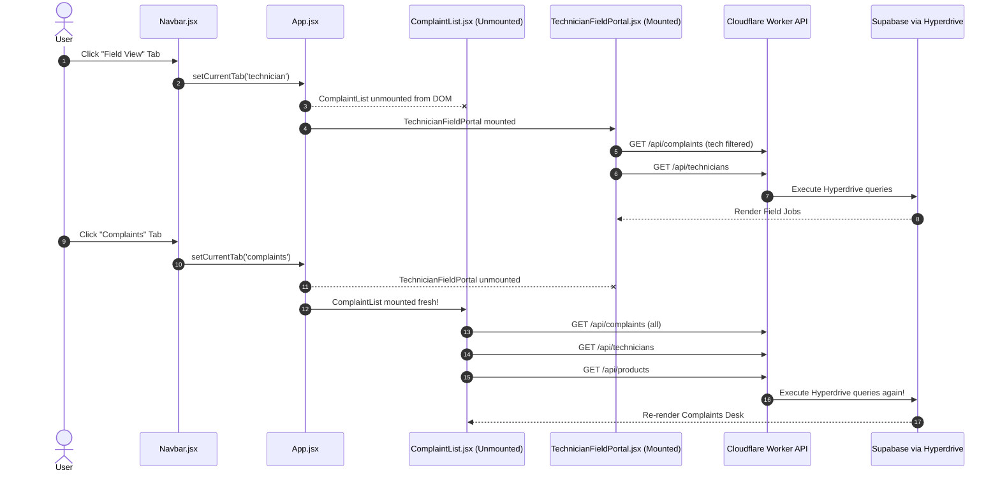

# 03. Complete API, Database & Caching Audit
**Project:** Eco Green Solar CMS (`eco-green-solar-cms`)  
**Audit Target:** Request Lifecycle, Polling Loops, Cache Mechanisms, Hyperdrive Query Consumption  
**Date:** October 2026  
**Auditor:** Senior Database Optimization Engineer & Backend Architect  

---

## 1. Executive Summary & Root Cause Analysis

### Why Does Navigating Between Sections Trigger Repeated API Requests?

Through rigorous source-code inspection of [`client/src/App.jsx`](file:///c:/Users/Administrator/.gemini/antigravity/scratch/eco-green-solar-cms/client/src/App.jsx), [`client/src/api/client.js`](file:///c:/Users/Administrator/.gemini/antigravity/scratch/eco-green-solar-cms/client/src/api/client.js), and individual view components, the root causes of repeated network and database requests have been conclusively verified:

1. **Component Unmount on Tab Change:**  
   In [`client/src/App.jsx`](file:///c:/Users/Administrator/.gemini/antigravity/scratch/eco-green-solar-cms/client/src/App.jsx#L557-L621), tab navigation conditionally renders views:
   ```jsx
   {currentTab === 'complaints' && <ComplaintList ... />}
   {currentTab === 'technician' && <TechnicianFieldPortal ... />}
   {currentTab === 'analytics' && <AnalyticsDashboard ... />}
   ```
   When a user clicks "Field View", `ComplaintList` is **completely destroyed and unmounted from memory**. When the user clicks back to "Complaints", a brand-new instance of `ComplaintList` is mounted. Its mount `useEffect()` runs immediately, firing network calls for `getComplaints()`, `getTechnicians()`, and `getProducts()`.

2. **Total Absence of an In-Memory Client Cache:**  
   Inspection of [`client/src/api/client.js`](file:///c:/Users/Administrator/.gemini/antigravity/scratch/eco-green-solar-cms/client/src/api/client.js) reveals that `api.getComplaints()` directly executes `await fetch('/api/complaints')`. While it saves the result to `localStorage` under `egs_permanent_complaints` as an emergency offline backup, **it never checks this storage before making the network request**. There is no cache hit, no `stale-while-revalidate`, and no request deduplication.

3. **Multiple Concurrent Polling Loops:**  
   Across the active codebase, 10 separate components maintain independent `setInterval` timers requesting data from Cloudflare Hyperdrive:
   - `NotificationContext.jsx` polls every 30s (`fetchFromBackend()`, `checkWhatsAppIncoming()`, `refreshTechAssignedTickets()`).
   - `ComplaintList.jsx` polls every 30s (`fetchComplaints(true)`).
   - `ComplaintDetailDrawer.jsx` polls every 30s (`fetchWhatsAppChat()`, `fetchTicketDetailsSilent()`).
   - `WhatsAppWebInbox.jsx` polls conversation list every 25s and active messages every 8s.
   - `AnalyticsDashboard.jsx` polls every 45s (calling 4 endpoints simultaneously).
   - `StaffTechnicianManager.jsx` polls every 30s.

4. **Lack of Server Response Caching Headers:**  
   Most Worker endpoints (`complaintRoutes.js`, `technicianRoutes.js`, `whatsappRoutes.js`) return standard `c.json(...)` without any `Cache-Control` header. Thus, neither the browser nor Cloudflare's CDN caches the response.

---

## 2. Request Flow Mapping: Initial Load vs. Tab Navigation

### A. Initial Page Load Request Waterfall (Admin Login)
When an admin user logs in or refreshes `https://complain.ecogreensolar.co.in/complaints`:

| Step | Request Endpoint | Triggering Component / File | Database Queries Generated (Hyperdrive) |
|---|---|---|:---:|
| 1 | `GET /api/auth/me` | `AuthContext.jsx` (Session verify) | 1 (`SELECT id, name, email, role FROM users`) |
| 2 | `GET /api/notifications` | `NotificationContext.jsx` (Mount) | 1 (`SELECT * FROM in_app_notifications`) |
| 3 | `GET /api/complaints` | `ComplaintList.jsx` (Mount) | 1 (`SELECT c.*, t.name ... FROM complaints ...` - Unpaginated) |
| 4 | `GET /api/technicians` | `ComplaintList.jsx` (Mount) | 1 Heavy query with 5 correlated subqueries per row |
| 5 | `GET /api/products` | `ComplaintList.jsx` (Mount) | 1 (`SELECT * FROM products`) |
| 6 | `GET /api/whatsapp/conversations` | `NotificationContext.jsx` (Mount) | 3–5 queries (messages CTE, installed customers, registry) |
| **Total** | **Initial Page Load:** | **6 Concurrent Network Requests** | **8 – 11 Hyperdrive Database Queries** |

---

### B. Request Waterfall on Tab Navigation (Without User Mutations)
When the user clicks another tab in the Navbar and returns:



**Finding:** Navigating between "Complaints" and "Field View" generates **5 new API calls and 6–8 database queries every single round-trip**, even if no data has changed in the system.

---

## 3. High-Cost Database Queries & Code Evidence

### Finding 1: Duplicate Correlated Subqueries in `GET /api/technicians`

- **File & Function:** [`worker/src/routes/technicianRoutes.js`](file:///c:/Users/Administrator/.gemini/antigravity/scratch/eco-green-solar-cms/worker/src/routes/technicianRoutes.js#L585-L596)
- **Endpoint:** `GET /api/technicians`
- **Code-Verified Query:**
  ```sql
  SELECT t.*, 
    (SELECT COUNT(*) FROM complaints c WHERE (c.assigned_technician_id::text = t.id::text OR c.secondary_technician_id::text = t.id::text) AND c.status IN ('Assigned', 'In Progress', 'Reopened')) as active_tickets_count,
    (SELECT COUNT(*) FROM complaints c WHERE (c.assigned_technician_id::text = t.id::text OR c.secondary_technician_id::text = t.id::text) AND c.status IN ('Assigned', 'In Progress', 'Reopened')) as active_jobs_count,
    (SELECT COUNT(*) FROM complaints c WHERE (c.assigned_technician_id::text = t.id::text OR c.secondary_technician_id::text = t.id::text) AND c.status = 'On Hold') as on_hold_count,
    (SELECT COUNT(*) FROM complaints c WHERE (c.assigned_technician_id::text = t.id::text OR c.secondary_technician_id::text = t.id::text) AND c.status IN ('Assigned', 'In Progress', 'On Hold', 'Reopened')) as total_open_count,
    (SELECT COUNT(*) FROM complaints c WHERE (c.assigned_technician_id::text = t.id::text OR c.secondary_technician_id::text = t.id::text) AND c.status IN ('Resolved', 'Closed')) as resolved_tickets_count
  FROM technicians t
  ORDER BY t.name ASC
  ```
- **Architectural Flaw:**
  1. `active_tickets_count` and `active_jobs_count` are **100% identical subqueries** written twice.
  2. For 15 technicians, this query evaluates **75 correlated subqueries** across the `complaints` table on every call.
  3. This query is called on initial load, on tab changes, and by multiple polling loops.
- **Recommended Solution:**
  Replace with a single `LEFT JOIN` and conditional aggregation:
  ```sql
  SELECT t.*,
    COUNT(CASE WHEN c.status IN ('Assigned', 'In Progress', 'Reopened') THEN 1 END) as active_tickets_count,
    COUNT(CASE WHEN c.status IN ('Assigned', 'In Progress', 'Reopened') THEN 1 END) as active_jobs_count,
    COUNT(CASE WHEN c.status = 'On Hold' THEN 1 END) as on_hold_count,
    COUNT(CASE WHEN c.status IN ('Assigned', 'In Progress', 'On Hold', 'Reopened') THEN 1 END) as total_open_count,
    COUNT(CASE WHEN c.status IN ('Resolved', 'Closed') THEN 1 END) as resolved_tickets_count
  FROM technicians t
  LEFT JOIN complaints c ON (c.assigned_technician_id::text = t.id::text OR c.secondary_technician_id::text = t.id::text)
  GROUP BY t.id
  ORDER BY t.name ASC;
  ```

---

### Finding 2: Unpaginated Full-Table Fetch in `GET /api/complaints`

- **File & Function:** [`worker/src/routes/complaintRoutes.js`](file:///c:/Users/Administrator/.gemini/antigravity/scratch/eco-green-solar-cms/worker/src/routes/complaintRoutes.js#L250-L315)
- **Endpoint:** `GET /api/complaints`
- **Current Behavior:**
  ```sql
  SELECT c.*, t.name as technician_name, t.phone as technician_phone, st.name as secondary_technician_name, st.phone as secondary_technician_phone
  FROM complaints c
  LEFT JOIN technicians t ON c.assigned_technician_id = t.id
  LEFT JOIN technicians st ON c.secondary_technician_id = st.id::text
  WHERE 1=1 ...
  ORDER BY c.created_at DESC
  ```
- **Architectural Flaw:**
  - `SELECT c.*` returns all 40+ columns, including long notes, diagnostic data, and serials.
  - No `LIMIT` or `OFFSET` is enforced by default.
  - When the organization reaches hundreds or thousands of complaints, each request transfers large payloads over the wire, increasing latency and database memory pressure.
- **Recommended Solution:**
  1. Introduce pagination (`LIMIT 50 OFFSET :page`) on the API.
  2. Support selective column projection (e.g. `SELECT id, ticket_id, customer_name, customer_phone, city, status, priority, product_type, assigned_technician_id, created_at`) for list views, leaving detailed fields for the drawer.

---

### Finding 3: Quadruple Redundant Fetching in `AnalyticsDashboard.jsx`

- **File & Function:** [`client/src/components/admin/AnalyticsDashboard.jsx`](file:///c:/Users/Administrator/.gemini/antigravity/scratch/eco-green-solar-cms/client/src/components/admin/AnalyticsDashboard.jsx#L716-L721)
- **Current Behavior:**
  ```javascript
  const [metricData, complaintsRes, techsRes] = await Promise.all([
    api.getMetrics().catch(() => null),     // 1. GET /api/reports/metrics
    api.getComplaints().catch(() => null),  // 2. GET /api/complaints (full table)
    api.getTechnicians().catch(() => null), // 3. GET /api/technicians (correlated subqueries)
    fetchCustomerStats()                    // 4. GET /api/customers/stats
  ]);
  ```
- **Architectural Flaw:**
  - `api.getMetrics()` already executes SQL aggregates in PostgreSQL to compute totals, counts, and financial sums.
  - Yet `AnalyticsDashboard` simultaneously requests the entire unpaginated complaints array and technicians list to re-compute the exact same metrics client-side.
- **Recommended Solution:**
  Have `AnalyticsDashboard` rely strictly on `api.getMetrics()` and `api.getCustomerStats()`. Only fetch the complaints list if the user explicitly switches to a drilled-down filtered sub-view.

---

## 4. Comprehensive Endpoint Classification Matrix

To ensure caching can be implemented safely without causing stale data or accounting errors, all endpoints are categorized into five distinct tiers:

```
+---------------------------------------------------------------------------------------------------------+
|                                    ENDPOINT CACHING CLASSIFICATION                                      |
+------+-----------------------------+-----------------------+------------------+-------------------------+
| Tier | Description                 | Recommended TTL       | Invalidation     | Example Endpoints       |
+------+-----------------------------+-----------------------+------------------+-------------------------+
| A    | Short-Lived Caching         | 30 to 60 seconds      | Periodic / Event | `/api/complaints`       |
| B    | Longer-Lived Caching        | 5 to 60 minutes       | On Mutation      | `/api/products`         |
| C    | Immediate Invalidation      | Mutates state         | Immediate purge  | `POST /assign`, `close` |
| D    | Real-Time / Polling         | 10 to 15 seconds      | Live Sync        | `/api/whatsapp/messages`|
| E    | Sensitive Financial/Auth    | No Public Cache       | Strict / Auth    | `/api/tour-ledger`      |
+------+-----------------------------+-----------------------+------------------+-------------------------+
```

### Detailed Endpoint Catalog:

| Category | Endpoint | Method | Recommended Strategy | Invalidation Trigger | Potential Risk If Stale |
|---|---|---|---|---|---|
| **Tier A** (Short-Lived) | `/api/complaints` | `GET` | 30s in-memory client cache (`stale-while-revalidate`) | Any complaint creation, status change, or assignment | Staff viewing slightly delayed status of newly registered complaint |
| **Tier A** (Short-Lived) | `/api/technicians` | `GET` | 60s in-memory client cache | Adding/editing technician or changing on-duty status | Supervisor seeing technician as off-duty for a few seconds |
| **Tier A** (Short-Lived) | `/api/reports/metrics` | `GET` | 60s in-memory client cache | Refreshed every minute or on manual refresh click | KPI numbers lagging by up to 60 seconds (acceptable for analytics) |
| **Tier B** (Longer-Lived) | `/api/products` | `GET` | 10 minutes (Browser + Memory) | Admin edits product catalog in settings | Very low; product lines rarely change |
| **Tier B** (Longer-Lived) | `/api/location/pincode/:pin`| `GET` | 24 Hours (`Cache-Control: public, max-age=86400`) | Static directory | Zero risk; pincode geographical mappings do not change |
| **Tier B** (Longer-Lived) | `/api/whatsapp/templates` | `GET` | 15 minutes | Meta sync trigger | Low; HSM templates change only after Meta approval |
| **Tier C** (Mutation Purge)| `/api/complaints/:id/assign`| `POST`| Invalidate `complaints` & `technicians` cache | Immediate | Critical: Customer or tech work orders could be duplicated if cached |
| **Tier C** (Mutation Purge)| `/api/complaints/:id/resolve`| `POST`| Invalidate `complaints` & `metrics` cache | Immediate | Staff unaware that field job is finished |
| **Tier C** (Mutation Purge)| `/api/complaints/:id/payment`| `POST`| Invalidate `complaints` & `tour-ledger` cache | Immediate | Technician cash balance discrepancies |
| **Tier D** (Real-Time) | `/api/whatsapp/conversations`| `GET`| 15s cache, bypassed if tab visible | New inbound webhook received | Delay in staff seeing new customer WhatsApp message |
| **Tier D** (Real-Time) | `/api/whatsapp/messages/:phone`| `GET`| 8s cache for active chat | Outbound send or inbound webhook | Chat messages appearing out of sequence |
| **Tier E** (Sensitive / Zero Cache) | `/api/tour-ledger` | `GET` | `no-store, no-cache` | Never cached | **HIGH RISK**: Corrupting technician advance/expense balances |
| **Tier E** (Sensitive / Zero Cache) | `/api/auth/me` | `GET` | Session-only validation | Logout or 401 | User permission escalation or stale role |

---

## 5. Hyperdrive Query Optimization Recommendations

1. **Gate Polling by Document Visibility & User Focus:**  
   Ensure that **no background `setInterval` fires when the browser tab is hidden** (`document.visibilityState === 'hidden'`).
2. **Implement Client-Side Request Deduplication:**  
   If two components mount at the same time and request `GET /api/technicians`, merge them into a single in-flight Promise so only one request hits the edge worker.
3. **Consolidate Correlated Subqueries:**  
   Refactor `GET /api/technicians` to use a `LEFT JOIN` and conditional `COUNT(CASE WHEN ...)` to reduce PostgreSQL CPU cycles.
4. **Enforce Response Caching on Static Catalog:**  
   Ensure `GET /api/products` and `GET /api/location/*` return appropriate `Cache-Control` headers so Vercel and Cloudflare CDN edges absorb repeat traffic.
