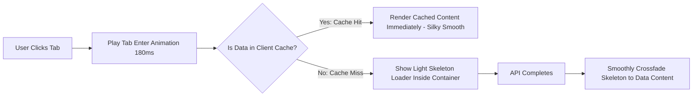

# 04. Complete Animation & Transition Readiness Audit
**Project:** Eco Green Solar CMS (`eco-green-solar-cms`)  
**Audit Target:** Animation Architecture, Interaction Motion, Transition System & Accessibility  
**Priority:** High  
**Date:** October 2026  
**Auditor:** Senior Animation Specialist & Frontend Performance Engineer  

---

## 1. Executive Summary: Current Animation Stack & Readiness

A thorough inspection of [`client/package.json`](file:///c:/Users/Administrator/.gemini/antigravity/scratch/eco-green-solar-cms/client/package.json), [`client/src/index.css`](file:///c:/Users/Administrator/.gemini/antigravity/scratch/eco-green-solar-cms/client/src/index.css), and component source files establishes the following verified facts:

1. **No External Animation Library is Installed:**  
   The project does **NOT** use `framer-motion`, `@motionone/dom`, or `gsap`.
2. **Current Implementation is CSS-First:**  
   The project currently relies on **pure CSS keyframes, CSS transitions, and custom utility classes** defined in [`client/src/index.css`](file:///c:/Users/Administrator/.gemini/antigravity/scratch/eco-green-solar-cms/client/src/index.css) (such as `.tab-content-enter`, `.modal-enter-scale`, `.drawer-enter-right`, `.drawer-exit-right`, and `.animate-in`).
3. **Tactile Micro-Interactions are Active:**  
   Universal button press feedback is active via `button:not(:disabled):active { transform: scale(0.965) translateZ(0); }`.
4. **Sliding Capsule Indicator:**  
   Navbar and status filters feature an Apple-inspired sliding green capsule powered by the [`useSlidingIndicator.js`](file:///c:/Users/Administrator/.gemini/antigravity/scratch/eco-green-solar-cms/client/src/hooks/useSlidingIndicator.js) React hook.
5. **Major Structural Gaps:**
   - **Abrupt Modal Disappearance:** When any modal (`NewComplaintModal`, `CustomerSearchModal`, `CustomerHistoryModal`, `TourModal`) is closed, it immediately returns `null`, vanishing in 0ms without any exit animation.
   - **Complete Absence of Reduced Motion Support:** There is **not a single `@media (prefers-reduced-motion)` rule** anywhere in the stylesheet.
   - **Non-GPU Sliding Indicator:** `useSlidingIndicator.js` animates `left` and `width` in pixels rather than GPU-accelerated `transform: translateX(...)` and `scaleX(...)`.
   - **Page Transition Stutter:** Navigating between tabs triggers `tab-content-enter` (opacity + translate3d), but because components unmount and fetch data afresh, the transition often stutters or displays a spinning loader.

---

## 2. Animation Architecture Evaluation: Should Framer Motion Be Added?

### Architectural Recommendation: **DO NOT INSTALL FRAMER MOTION**

**Evidence & Rationale:**
1. **Bundle Size Impact:** Adding `framer-motion` adds **~34 KB to 45 KB (minified + gzipped)** to the initial bundle. Given that the current entry bundle `index-Ct0p1eYD.js` is already **771 KB**, adding a heavy runtime library is counterproductive.
2. **React 19 Compatibility:** The project runs **React 19.2.8** (`"react": "^19.2.8"`). Older Framer Motion versions have peer dependency conflicts with React 19.
3. **The Current CSS System is 80% Complete:** The keyframes and easing curves in `index.css` are already high quality (using Apple-style cubic beziers like `cubic-bezier(0.16, 1, 0.3, 1)`).
4. **What is Truly Missing:** The missing ingredient is not a library, but **lifecycle coordination for exit animations** (allowing components to play an exit CSS animation before unmounting) and **consistent easing application**.

A lightweight, zero-dependency custom hook (`usePresence` or `useOverlayAnimation`) can coordinate exit transitions without adding any bundle weight.

---

## 3. Detailed Component Animation Inventory & Assessment

```
+--------------------------------------------------------------------------------------------------------------+
|                                  ANIMATION INVENTORY & READINESS                                             |
+----+-----------------------------+-----------------------+-----------------------+---------------------------+
| #  | Component / Interaction     | Current Behavior      | Missing / Defect      | Recommended Solution      |
+----+-----------------------------+-----------------------+-----------------------+---------------------------+
| 01 | Page / Tab Transitions      | `tab-content-enter`   | Stutters on refetch   | Keep in memory; smooth fade|
| 02 | Modal Dialogs (All)         | Keyframe scale-in     | 0ms abrupt close      | 180ms `zoom-out-95` exit  |
| 03 | Drawers (Tickets, Notifs)   | `drawer-enter/exit`   | Duplicated code       | Shared `useDrawerState`   |
| 04 | Navbar & Filter Tabs        | Sliding capsule       | Animates left/width   | Hardware-accelerated Xform|
| 05 | Button Interactions         | Scale 0.965 on active | Inconsistent hovers   | Unified subtle elevation  |
| 06 | Dropdown Menus              | Instant appearance    | No scale/fade-in      | 150ms `popoverEnter`      |
| 07 | Toast Notifications         | Slide-in from bottom  | Abrupt pop on remove  | Smooth slide-down exit    |
| 08 | Table Row Deletion          | Row vanishes instantly| No collapse transition| Height collapse transition|
| 09 | WhatsApp Message Bubbles    | Slide-in from bottom  | Consistent            | Maintain existing         |
| 10 | Skeleton Loaders            | CSS pulse             | Good, but static      | Subtle shimmer gradient   |
+----+-----------------------------+-----------------------+-----------------------+---------------------------+
```

---

## 4. Proposed Animation & Transition Specification Table

The following table provides the exact proposed specification for all CRM interface elements. All durations, easings, and techniques are designed for a clean, professional, enterprise-grade feel.

| Component / UI Element | Current Behavior | Recommended Behavior | Suggested Duration | Recommended Easing | Implementation Approach | Performance Risk |
|---|---|---|---|---|---|:---:|
| **Tab / Page Transition** | `tab-content-enter` (240ms translateY(8px) + fade) | Smooth crossfade with 4px subtle upward glide | **180ms** | `cubic-bezier(0.16, 1, 0.3, 1)` (Apple Smooth) | CSS Class (`tab-enter`) with `transform: translate3d(0,0,0)` | **Low** (GPU accelerated) |
| **Modal Open** | `modal-enter-scale` (Scale 0.96 -> 1, translateY 4px) | Maintain subtle scale-in with natural deceleration | **200ms** | `cubic-bezier(0.16, 1, 0.3, 1)` | CSS Keyframes (`modalEnterScale`) | **Low** |
| **Modal Exit / Close** | **None** (Abruptly unmounts in 0ms) | Smooth scale down (1 -> 0.96) and fade-out before unmounting | **160ms** | `cubic-bezier(0.25, 1, 0.5, 1)` (Ease-out quad) | Coordinated via `useOverlayAnimation` hook + `.modal-exit-scale` | **Low** |
| **Drawer Slide-In** | `drawer-enter-right` (translate3d 100% -> 0%) | Fluid edge glide with Apple Spring deceleration | **240ms** | `cubic-bezier(0.32, 0.72, 0, 1)` (Apple Spring) | CSS Class (`drawer-enter-right`) | **Low** |
| **Drawer Slide-Out** | `drawer-exit-right` (translate3d 0% -> 100%) | Swift acceleration off-screen | **180ms** | `cubic-bezier(0.25, 1, 0.5, 1)` | CSS Class (`drawer-exit-right`) | **Low** |
| **Dropdown / Popover** | Instant DOM render without transition | Origin-anchored scale (0.95 -> 1) with fast fade | **140ms** | `cubic-bezier(0.16, 1, 0.3, 1)` | CSS Keyframe (`popoverEnter`) with `transform-origin: top right` | **Zero** |
| **Sliding Tab Indicator** | `left` and `width` updated via layout state | Transform translation: `transform: translateX(Xpx) scaleX(S)` | **200ms** | `cubic-bezier(0.16, 1, 0.3, 1)` | Refactor `useSlidingIndicator` to output CSS transforms | **Zero** (eliminates layout reflow) |
| **Button Press (Active)**| `scale(0.965)` with 160ms transition | Tactile micro-compression with instant 0ms touch-down | **120ms** return | `cubic-bezier(0.16, 1, 0.3, 1)` | CSS `:active` with `translateZ(0)` | **Zero** |
| **Toast Notification** | Slide-in from bottom 3 | Spring pop-in + fluid slide-out on dismiss | **220ms** enter / **160ms** exit | `cubic-bezier(0.34, 1.56, 0.64, 1)` (Enter spring) | CSS Keyframes with `pointer-events-auto` | **Low** |
| **Table List Update** | Rows instantly replace on filter change | Subtle stagger fade for top 5 rows (15ms delay increment) | **150ms** | `cubic-bezier(0.16, 1, 0.3, 1)` | CSS class with `animation-delay: calc(var(--i) * 15ms)` | **Low** |
| **Accordion / Collapsible**| Instant expand/collapse | Smooth height transition using CSS grid `grid-template-rows: 0fr -> 1fr` | **220ms** | `cubic-bezier(0.16, 1, 0.3, 1)` | Modern CSS Grid transition (no JS height calculation) | **Low** |

---

## 5. Interaction Between Animations, API Loading & Caching

A frequent source of user dissatisfaction in SPAs occurs when animations collide with asynchronous data loading:



### Key Interaction Rules:
1. **Never Block User Clicks During Animation:**  
   Do not disable pointer events on containers while animations are running. The user should be able to click or navigate immediately.
2. **No Animation Re-Run on Cached Revisit:**  
   When navigating back to a tab that is already loaded and cached, **do not trigger full-screen staggered entrance animations**. The content should appear stable and ready instantly.
3. **Skeleton-to-Content Crossfade:**  
   When an API request resolves, crossfade from skeleton to real content using a quick **140ms fade-in** (`opacity: 0 -> 1`), preventing harsh layout jumps.
4. **Decouple Animations from Network Timeouts:**  
   Animations must always complete their visual duration regardless of whether an API call takes 50ms or 5,000ms.

---

## 6. Accessibility & `prefers-reduced-motion` Compliance

### Required Global Accessibility Rule
To comply with WCAG 2.1 Success Criterion 2.3.3 (Animation from Interactions), the following must be added to [`client/src/index.css`](file:///c:/Users/Administrator/.gemini/antigravity/scratch/eco-green-solar-cms/client/src/index.css):

```css
@media (prefers-reduced-motion: reduce) {
  *,
  *::before,
  *::after {
    animation-duration: 0.01ms !important;
    animation-iteration-count: 1 !important;
    transition-duration: 0.01ms !important;
    scroll-behavior: auto !important;
  }
  
  .tab-content-enter,
  .modal-enter-scale,
  .drawer-enter-right,
  .drawer-exit-right {
    animation: none !important;
    transform: none !important;
    opacity: 1 !important;
  }
}
```

This guarantees that users who experience vestibular motion disorders or who have enabled reduced motion in Windows or macOS will have an instant, accessible experience without discomfort.
