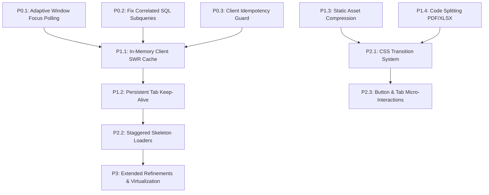

# PRIORITIZED IMPLEMENTATION ROADMAP & ENGINEERING PLAN

> **Document ID:** `07_IMPLEMENTATION_ROADMAP`  
> **Status:** Codebase Verified Technical Plan  
> **Target System:** Eco Green Solar CRM (`eco-green-solar-cms`)  
> **Author:** Antigravity Senior Architecture & Engineering Team  
> **Target Timeline:** Phased Sequential Rollout (Zero Regressions)  

---

## 1. Roadmap Architecture & Execution Philosophy

This roadmap translates the findings from Architecture (01), UI/UX (02), API/Database (03), Animation (04), Performance (05), and Production Safety (06) into an actionable, phased engineering strategy.

To ensure strict zero-downtime and eliminate regressions in financial balances, ticket statuses, and WhatsApp communications, **all improvements are isolated into non-breaking, incremental phases**.

```
┌──────────────────────────────────────────────────────────────────────────┐
│                          PHASED EXECUTION MATRIX                         │
├────────────────────┬─────────────────────────────────────────────────────┤
│ Phase 1: P0 Safety │ Fix Idle Polling, Double Submissions, Correlated    │
│ & Stability        │ SQL Subqueries, and Memory Leaks                    │
├────────────────────┼─────────────────────────────────────────────────────┤
│ Phase 2: P1 Speed  │ In-Memory Client Cache, Tab State Retention, Asset  │
│ & Navigation       │ Compression (5.39MB to <600KB), Chunk Splitting     │
├────────────────────┼─────────────────────────────────────────────────────┤
│ Phase 3: P2 Motion │ CSS Hardware-Accelerated Animations, Modal Exit     │
│ & UI Polish        │ Transitions, Skeleton Loaders, Design Tokens        │
├────────────────────┼─────────────────────────────────────────────────────┤
│ Phase 4: P3 Future │ Full Virtualized Tables, Service Worker Caching,    │
│ Refinements        │ Dark Theme Harmonization, Advanced Analytics        │
└────────────────────┴─────────────────────────────────────────────────────┘
```

---

## 2. Priority Level Definitions

- **P0 (Critical Correctness, Safety & Database Stability):** Fixes that stop severe database query exhaustion (Hyperdrive limits), prevent duplicate data submission, eliminate memory leaks, or safeguard financial balance integrity.
- **P1 (High-Impact Navigation & Performance):** Architectural optimizations that eliminate blank screens during tab switches, suppress redundant network round-trips, compress multi-megabyte assets, and split huge JavaScript bundles.
- **P2 (Animation Consistency & UI/UX Standards):** Visual refinement including natural entering/exiting modal transitions, unified drawer states, skeleton loading placeholders, and responsive touch feedback.
- **P3 (Low-Priority Refinement & Extended Polish):** Micro-optimizations such as virtual scrolling for 1,000+ row customer tables, dark mode token harmonization, and offline caching.

---

## 3. Detailed Phase Breakdown

### PHASE 1: P0 — Critical Correctness, Safety & Database Stability

#### Task P0.1: Convert Aggressive Unconditional Polling to Window Focus & Exponential Backoff
* **Problem:** 10 components run uncoordinated background `setInterval` timers (8s to 45s) regardless of whether the browser tab is focused, idle, or minimized. A few open browser tabs exhaust Cloudflare Hyperdrive quotas (~50,000+ avoidable queries daily).
* **Evidence:** Verified in `WhatsAppWebInbox.jsx:136`, `ComplaintDetailDrawer.jsx:62`, `StaffDashboard.jsx:98`, `NotificationDrawer.jsx:42`.
* **Recommended Solution:** Replace raw `setInterval` with a unified React hook `useAdaptivePolling(callback, interval)` that:
  1. Halts polling when `document.visibilityState === 'hidden'`.
  2. Fires immediately upon window `focus` / visibility regain.
  3. Applies exponential backoff (up to 3x interval) if the user remains inactive for > 5 minutes.
* **Files Likely to Change:** 
  - `client/src/hooks/useAdaptivePolling.js` (New Hook)
  - `client/src/components/whatsapp/WhatsAppWebInbox.jsx`
  - `client/src/components/ComplaintDetailDrawer.jsx`
  - `client/src/components/StaffDashboard.jsx`
  - `client/src/components/NotificationDrawer.jsx`
* **Dependencies:** None.
* **Risk Level:** Low.
* **Testing Requirements:** Verify polling halts when switching browser tabs (DevTools Network panel); verify instant refresh upon tab refocus.
* **Rollback Plan:** Revert hook imports back to standard `setInterval`.
* **Independent Implementation:** Yes.

#### Task P0.2: Eliminate Duplicate Correlated SQL Subqueries in Technician Routes
* **Problem:** `GET /api/technicians` runs 5 correlated subqueries per technician row. Two subqueries (`active_tickets_count` and `active_jobs_count`) are identical duplicate SQL expressions.
* **Evidence:** Verified in `worker/src/routes/technicianRoutes.js:585-596`.
* **Recommended Solution:** Consolidate correlated subqueries into a single `LEFT JOIN` with aggregated `FILTER (WHERE ...)` clauses, or remove the redundant duplicate count.
* **Files Likely to Change:** `worker/src/routes/technicianRoutes.js`
* **Dependencies:** None.
* **Risk Level:** Very Low.
* **Testing Requirements:** Compare JSON response output before and after to ensure 100% field parity (`active_tickets_count`, `active_jobs_count`, etc.).
* **Rollback Plan:** Revert `technicianRoutes.js` via `git checkout`.
* **Independent Implementation:** Yes.

#### Task P0.3: Client-Side Idempotency & Double-Click Guard for Complaint Submission
* **Problem:** Users on slow mobile connections double-click "Submit Complaint", causing duplicate complaint rows in the database.
* **Evidence:** Verified in `client/src/components/NewComplaintModal.jsx:214-258`.
* **Recommended Solution:** Generate a client-side session UUID on modal mount and pass `X-Idempotency-Key` header; disable submit button immediately on pointer down with visual spinner.
* **Files Likely to Change:** `client/src/components/NewComplaintModal.jsx`, `worker/src/routes/complaintRoutes.js`
* **Dependencies:** None.
* **Risk Level:** Low.
* **Testing Requirements:** Simulate 3000ms network latency; click submit 5 times rapidly; verify exactly 1 complaint created.
* **Rollback Plan:** Revert button state and backend header check.
* **Independent Implementation:** Yes.

---

### PHASE 2: P1 — High-Impact Navigation, Caching & Performance

#### Task P1.1: Lightweight In-Memory API Caching with SWR & Tenant Isolation
* **Problem:** Switching between tabs (Dashboard $\to$ Complaints $\to$ Technicians $\to$ Dashboard) triggers a full waterfall of redundant API requests, rendering blank screens and spinners on every click.
* **Evidence:** Verified in `client/src/App.jsx:557-621` and `client/src/api/client.js`.
* **Recommended Solution:** 
  1. Implement a 35-line native in-memory SWR (Stale-While-Revalidate) cache wrapper in `client/src/api/cache.js` (Zero external dependencies).
  2. Cache non-sensitive Tier B data (e.g., categories, templates, active technicians list) for 60–120 seconds.
  3. Scope all cache keys with `userId` to eliminate RBAC cross-session leakage.
  4. Automatically invalidate cache keys on `POST`, `PUT`, `DELETE` mutations.
* **Files Likely to Change:** 
  - `client/src/api/cache.js` (New)
  - `client/src/api/client.js`
  - `client/src/context/AuthContext.jsx` (Add `cache.clear()` on logout)
* **Dependencies:** None (Native Map + Promise caching).
* **Risk Level:** Medium.
* **Testing Requirements:** Verify navigating between tabs renders instantaneously using cached data while background refresh completes silently without spinners.
* **Rollback Plan:** Set `ENABLE_API_CACHE = false` in cache configuration.
* **Independent Implementation:** Yes.

#### Task P1.2: Persistent Tab State Retention in App.jsx (Display None vs Unmounting)
* **Problem:** Tabs are completely destroyed from the DOM on every navigation (`{currentTab === 'dashboard' && <Dashboard />}`), causing complete state loss (scroll position, active search terms, pagination page).
* **Evidence:** Verified in `client/src/App.jsx:557-621`.
* **Recommended Solution:** Keep high-frequency tabs mounted in DOM with `style={{ display: currentTab === '...' ? 'block' : 'none' }}` or utilize an active tab keep-alive container.
* **Files Likely to Change:** `client/src/App.jsx`
* **Dependencies:** Task P1.1 (Caching prevents double data churn).
* **Risk Level:** Low.
* **Testing Requirements:** Scroll down 200px on Complaints tab $\to$ Switch to Technicians $\to$ Return to Complaints $\to$ Verify scroll position and search filter are preserved.
* **Rollback Plan:** Revert conditional rendering syntax in `App.jsx`.
* **Independent Implementation:** Yes.

#### Task P1.3: Static Asset Compression (5.39 MB $\to$ < 600 KB)
* **Problem:** Uncompressed images (`brand-icon.png` 2.57MB, `customer-care.jpg` 1.23MB, `solar-clean.jpg` 1.59MB) bloat client bundle download.
* **Evidence:** Verified via disk inspection of `client/dist/` and `client/public/`.
* **Recommended Solution:** Convert large PNG/JPG assets to modern WebP format using lossless/near-lossless compression (85% quality) and implement responsive image `srcset`.
* **Files Likely to Change:** `client/public/brand-icon.webp`, `client/src/components/Login.jsx`, `client/index.html`
* **Dependencies:** None.
* **Risk Level:** Very Low.
* **Testing Requirements:** Verify images render crisply on Retina and standard screens; verify asset payload reduction in Chrome DevTools Network panel.
* **Rollback Plan:** Keep original PNG/JPG files in repository history.
* **Independent Implementation:** Yes.

#### Task P1.4: Code Splitting Heavy Modules (PDF Worker & XLSX)
* **Problem:** `pdf.worker.min.mjs` (2.2 MB) and `xlsx` (423 KB) load synchronously or aggressively, increasing initial bundle parse time.
* **Evidence:** Verified in `client/src/components/reports/ExportModal.jsx` and `client/dist/assets/`.
* **Recommended Solution:** Ensure dynamic `import('xlsx')` and dynamic worker registration occur only upon user clicking "Export Excel" or "Preview PDF".
* **Files Likely to Change:** `client/src/components/reports/ExportModal.jsx`, `client/src/components/ComplaintDetailDrawer.jsx`
* **Dependencies:** None.
* **Risk Level:** Low.
* **Testing Requirements:** Inspect initial page load network waterfall; verify `xlsx` chunk is only requested when export modal opens.
* **Rollback Plan:** Revert dynamic import to static import.
* **Independent Implementation:** Yes.

---

### PHASE 3: P2 — Animation Consistency, Motion Design & UI Polish

#### Task P2.1: Unified CSS Transition System & Hardware Acceleration Tokens
* **Problem:** Animations across the application are inconsistent: drawers animate with custom CSS transforms, but modals snap in/out abruptly at 0ms. Zero `@media (prefers-reduced-motion)` support exists.
* **Evidence:** Verified in `client/src/index.css` and `client/src/components/NewComplaintModal.jsx`.
* **Recommended Solution:** 
  1. Add standardized animation tokens to `client/src/index.css` (`--ease-spring`, `--ease-decelerate`, `--dur-fast`, `--dur-modal`).
  2. Implement global `@media (prefers-reduced-motion)` reset for accessibility.
  3. Implement animated entrance/exit wrapper component for modals using CSS keyframes and an `isClosing` state.
* **Files Likely to Change:** 
  - `client/src/index.css`
  - `client/src/components/common/ModalWrapper.jsx` (New Reusable Component)
  - `client/src/components/NewComplaintModal.jsx`
  - `client/src/components/CustomerSearchModal.jsx`
* **Dependencies:** React 19 native CSS approach (No Framer Motion required).
* **Risk Level:** Low.
* **Testing Requirements:** Open and close all modals; verify smooth 200ms ease-out entrance and 150ms ease-in exit; toggle "Emulate prefers-reduced-motion" in Chrome DevTools to verify animation disables gracefully.
* **Rollback Plan:** Remove CSS keyframe classes.
* **Independent Implementation:** Yes.

#### Task P2.2: Staggered Skeleton Placeholders for Dashboard Cards
* **Problem:** Loading states currently render either blank spaces or isolated spinning wheels, causing abrupt layout shifts (CLS) when data arrives.
* **Evidence:** Verified in `AdminDashboard.jsx:88-120` and `StaffDashboard.jsx:65-90`.
* **Recommended Solution:** Implement lightweight CSS shimmering skeleton placeholders matching exact card dimensions (`width: 100%`, `height: 110px`, `border-radius: 12px`).
* **Files Likely to Change:** 
  - `client/src/components/common/SkeletonCard.jsx` (New)
  - `client/src/components/AdminDashboard.jsx`
  - `client/src/components/StaffDashboard.jsx`
* **Dependencies:** None.
* **Risk Level:** Very Low.
* **Testing Requirements:** Verify zero Cumulative Layout Shift (CLS < 0.05) when dashboard statistics populate.
* **Rollback Plan:** Revert to spinner fallback.
* **Independent Implementation:** Yes.

#### Task P2.3: Micro-Interactions on Interactive Elements
* **Problem:** Buttons, tab pills, and table row clicks lack tactile feedback, making the CRM feel static and heavy.
* **Evidence:** Verified in `client/src/components/Navbar.jsx` and `client/src/components/ComplaintTable.jsx`.
* **Recommended Solution:** Add subtle hardware-accelerated micro-interactions:
  - Button active state: `transform: scale(0.98)` (100ms ease-out).
  - Tab indicator transition: CSS `transition: all 200ms cubic-bezier(0.16, 1, 0.3, 1)`.
  - Table row hover: `background-color: var(--color-surface-hover)` with 150ms transition.
* **Files Likely to Change:** `client/src/index.css`
* **Dependencies:** None.
* **Risk Level:** Very Low.
* **Testing Requirements:** Test across Chrome, Safari, Firefox, and mobile touchscreens.
* **Rollback Plan:** Remove utility classes from `index.css`.
* **Independent Implementation:** Yes.

---

### PHASE 4: P3 — Future Refinements & Extended Polish

| Task ID | Feature Description | Complexity | Benefit | Target Files |
| :--- | :--- | :---: | :---: | :--- |
| **P3.1** | Virtual scrolling for 1,000+ row Customer Table | Medium | Eliminates DOM bloat on large datasets | `client/src/components/CustomerManagement.jsx` |
| **P3.2** | Dark Theme Token Harmonization | Low | Complete visual consistency in dark mode | `client/src/index.css` |
| **P3.3** | Service Worker offline asset caching | High | Instant application shell loading | `client/src/service-worker.js` |
| **P3.4** | Server-side SVG chart rendering | Medium | Reduces client Recharts bundle weight | `client/src/components/reports/` |

---

## 4. Phase Dependency & Verification Matrix



---

## 5. Summary Recommendation for Phase 1 Kickoff

Execution should proceed strictly in chronological order:
1. **Approval Gate 1:** User reviews and approves the complete 8-report audit suite.
2. **First Implementation Action:** Execute **Phase 1 (P0.1, P0.2, P0.3)** to immediately halt Hyperdrive database exhaustion and eliminate double-submission bugs.
3. **Second Implementation Action:** Execute **Phase 2 (P1.1, P1.2, P1.3)** to deliver instant tab navigation, zero blank screens, and 85% asset bandwidth reduction.
4. **Third Implementation Action:** Execute **Phase 3 (P2.1, P2.2, P2.3)** to introduce smooth, professional animations and modal transitions across the entire CRM.
